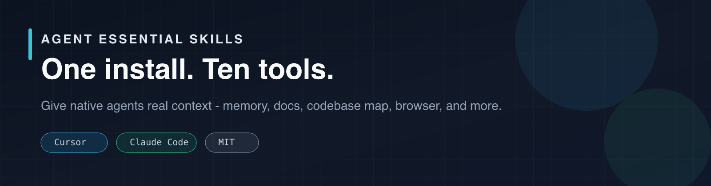
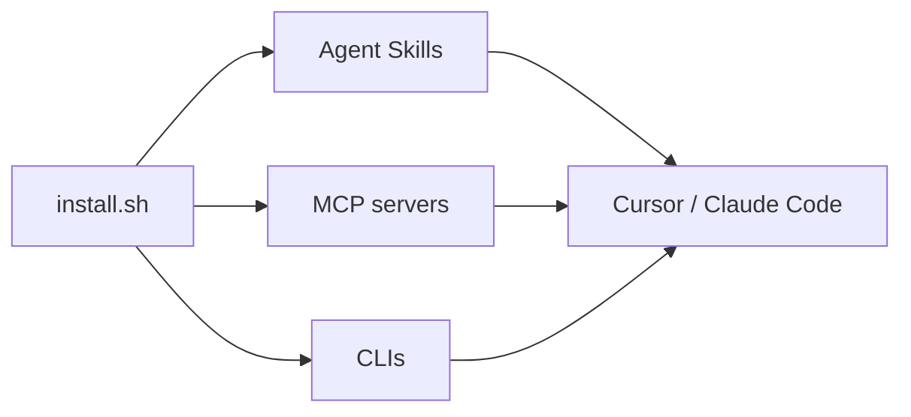

<p align="center">
  
</p>

<p align="center">
  <strong>One install. Ten open-source tools. Native agents that actually have context.</strong>
</p>

<p align="center">
  <a href="LICENSE"></a>
  <a href="tools.json"></a>
  <a href="#quick-start"></a>
  <a href="https://github.com/DrSalmanAfridi/Agent-Essential-Skills/stargazers"></a>
</p>

---

## Why this exists

ChatGPT, Cursor, and Claude are only as good as the context you give them.  
Out of the box they forget sessions, guess docs, miss codebase structure, and cannot open a browser.

**Agent Essential Skills** is a one-command bundle that wires ten proven open-source projects into **Cursor** and **Claude Code** — skills, MCP servers, and CLIs — without copying those projects into this repo.

```text
You  →  install.sh  →  Skills + MCP + CLIs  →  Agent with real context
```

---

## Quick start

**Requirements:** Node.js 22+, and [uv](https://docs.astral.sh/uv/) (for graphify + serena).

```bash
git clone https://github.com/DrSalmanAfridi/Agent-Essential-Skills.git
cd Agent-Essential-Skills
bash scripts/install.sh --dry-run   # preview only
bash scripts/install.sh             # full install
```

Then restart Cursor / Claude Code.

Two tools are stronger with a free API key (**Context7**, **Firecrawl**). Everything else works without keys → [docs/KEYS.md](docs/KEYS.md).

### Safety

`scripts/install.sh` edits agent configs (`~/.cursor/mcp.json`, `~/.claude.json`). Before changing a file it writes a timestamped backup next to it (`*.bak-YYYYMMDD-HHMMSS`). Invalid JSON is left untouched. Optional API keys that are not set are omitted (never written as literal `${…}` placeholders).

```bash
bash scripts/install.sh --dry-run     # show what would happen, change nothing
bash scripts/install.sh --mcp-only    # only wire MCP servers (no skills/CLIs)
bash scripts/install.sh               # full install
```

---

## The stack

| # | Tool | Type | What it fixes |
|---|------|------|----------------|
| 1 | [claude-mem](https://github.com/thedotmack/claude-mem) | Memory | Agents forget between sessions |
| 2 | [context7](https://github.com/upstash/context7) | MCP / skill | Agents invent outdated APIs |
| 3 | [graphify](https://github.com/Graphify-Labs/graphify) | CLI / skill | Blind grepping in large repos |
| 4 | [ponytail](https://github.com/DietrichGebert/ponytail) | Skill | Over-engineered, bloated code |
| 5 | [playwright-mcp](https://github.com/microsoft/playwright-mcp) | MCP | No way to test the UI it built |
| 6 | [superpowers](https://github.com/obra/superpowers) | Skill / plugin | Jumping into code with no plan |
| 7 | [repomix](https://github.com/yamadashy/repomix) | CLI / skill | Need the whole repo in one file |
| 8 | [firecrawl](https://github.com/firecrawl/firecrawl) | MCP / API | No live web / page data |
| 9 | [serena](https://github.com/oraios/serena) | MCP | No IDE-grade symbol edit tools |
| 10 | [caveman](https://github.com/JuliusBrussee/caveman) | Skill | Token waste on filler prose |

Machine-readable catalog: [`tools.json`](tools.json).

---

## What the installer does

`scripts/install.sh` configures your machine for Cursor + Claude Code:

1. **Skills** — `ponytail`, `caveman`, `superpowers`, `repomix`, `graphify`
2. **CLIs** — `repomix`, `graphify`, `serena`, plus interactive `claude-mem` / `ctx7` setup
3. **MCP** — merges Playwright, Context7, Firecrawl, and Serena into `~/.cursor/mcp.json` and `~/.claude.json`

This repository **does not vendor** upstream code. It installs and wires the original projects. Licenses and credit stay with their authors.



---

## After install

1. Restart Cursor and Claude Code  
2. Optional keys → [docs/KEYS.md](docs/KEYS.md)  
3. In a project: `graphify .`  
4. Try `/ponytail`, or ask the agent to open a page with Playwright  

---

## Honest notes

- Not all ten items are “skills.” Some are skills, some are MCP servers, some are CLIs. The installer handles the mix.
- Context7 and Firecrawl stay optional until you add keys.
- Caveman’s large “% tokens saved” claims apply mainly to chatty answers; coding sessions usually see smaller gains.

---

## Contributing / credits

PRs that improve the installer, docs, or catalog are welcome.  
All bundled tools belong to their upstream maintainers — thank you to those projects.

## License

[MIT](LICENSE) for this bundle’s scripts and documentation.  
Upstream tools keep their own licenses.
